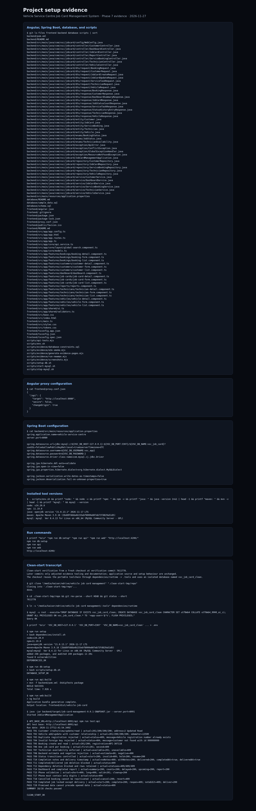
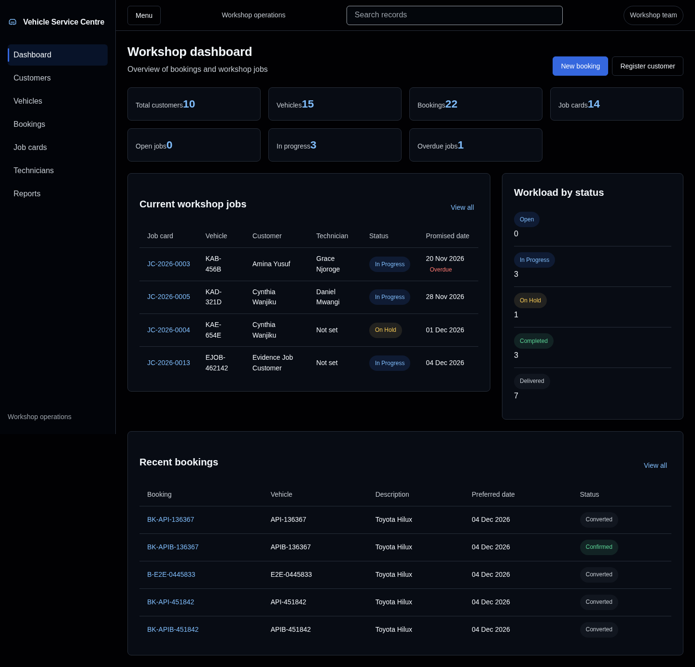
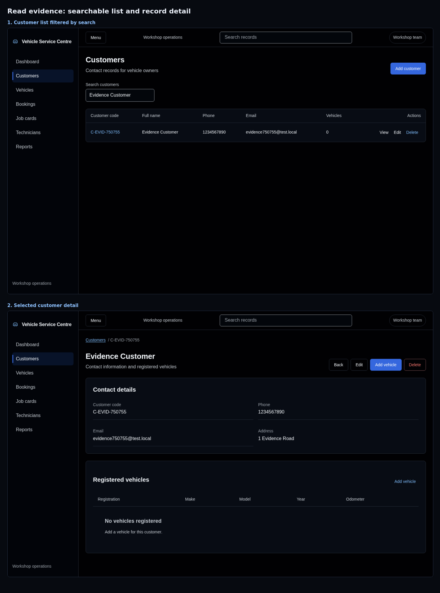
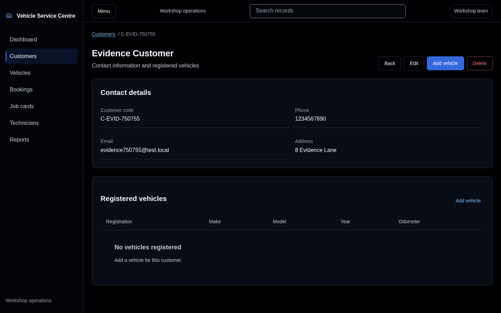
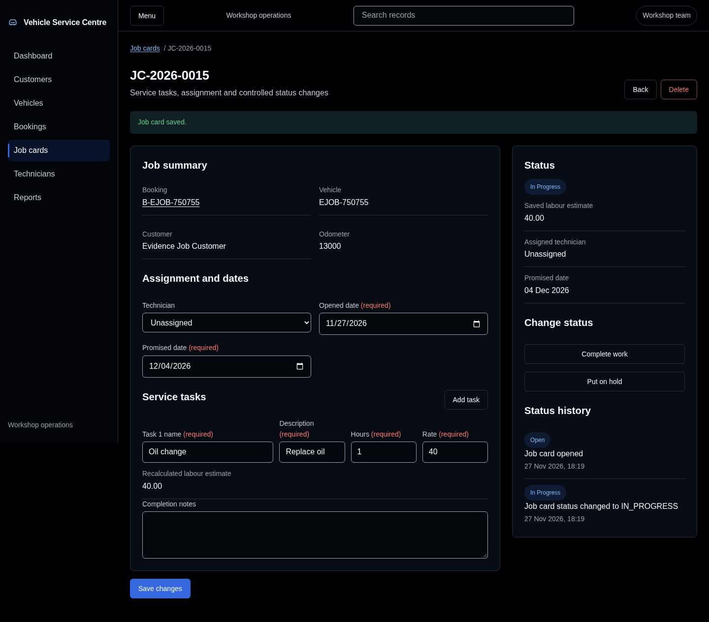
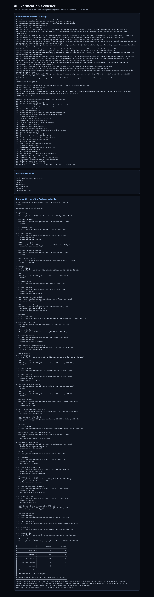
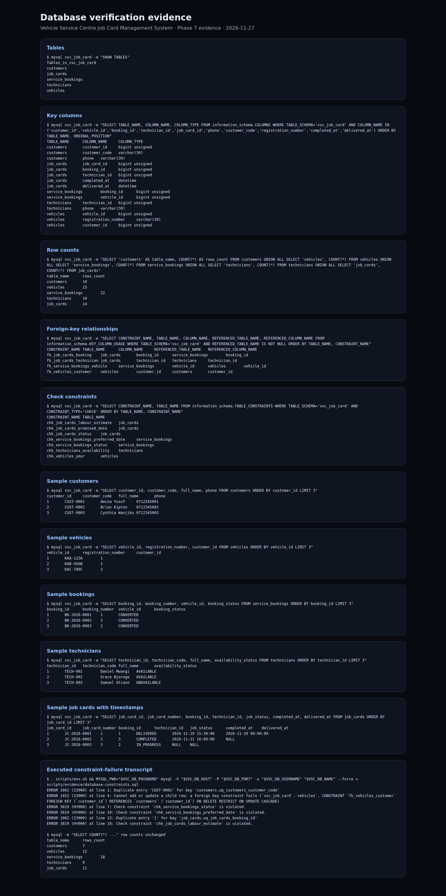

# Vehicle Service Centre Job Card Management System

Full-stack CRUD and workflow application for customers, vehicles, service bookings, technicians, and job cards. The Angular UI uses a live Spring Boot API and MySQL database; there is no mock data.

## Features

- Customer, vehicle, technician, booking, and job-card management
- Booking confirmation and one job card per confirmed booking
- Technician allocation and availability checks
- Task-level labour estimates calculated by the backend
- Job status history with allowed transitions only
- Protected deletion for linked or completed records
- Dashboard with live counts, overdue jobs, upcoming jobs, and status breakdown
- Completed-job report with client-side date and status filters

## Tech stack and verified versions

| Technology | Version |
|---|---|
| Angular / Angular CLI | 22.3.0 |
| Node.js | 24.20.0 |
| npm | 11.19.0 |
| Java / Temurin JDK | 21.0.13.1+2 |
| Apache Maven | 3.9.16 |
| MySQL | 8.4.13 |

## Repository structure

```text
backend/        Spring Boot source and pom.xml
frontend/       Angular source, package.json, package-lock.json
database/       schema.sql and sample_data.sql; ER diagram is in docs/er-diagram.md
docs/           API contract, API summary, Postman collection, test matrix, supervisor confirmations, evidence
dependencies/   single dependency setup entry point and versions
scripts/        local startup, shutdown, and environment scripts
api/            Vercel serverless API proxy
vercel.json     Vercel build and SPA routing configuration
.env.example    non-secret environment template
```

All dependency declarations and setup commands are collected under `dependencies/`. Runtime binaries placed in `dependencies/runtime/` are ignored by Git. Never commit `.env`, passwords, or runtime binaries.

## Local installation and run

### 1. Configure the environment

```bash
cp .env.example .env
```

Edit `.env` and set your own `VSC_DB_PASSWORD` and `VSC_DB_ROOT_PASSWORD`. `scripts/env.sh` now loads `.env` automatically for the npm-driven setup, database, and backend commands, so no manual `source` step is needed.

### 2. Install dependencies

```bash
npm run setup
```

This installs Angular packages from `frontend/package-lock.json` and verifies Node.js, npm, Java, Maven, and MySQL are available. If you use portable runtimes, put them under `dependencies/runtime/`; `scripts/env.sh` will detect them automatically.

### 3. Start the database

```bash
npm run db:setup
```

This starts the bundled MySQL runtime when present and loads `database/schema.sql` and `database/sample_data.sql`. If you use a system MySQL server, start it before running this command and ensure the credentials in `.env` are correct.

### 4. Start the backend

```bash
npm run api
```

Spring Boot runs at `http://localhost:8080`.

### 5. Start the Angular app

```bash
npm run web
```

Open `http://localhost:4200/`. The Angular dev server proxies `/api` to `http://localhost:8080` through `frontend/proxy.conf.json`.

### 6. Stop services

```bash
npm run db:stop
```

Stop the backend and Angular processes with `Ctrl+C` in their terminals.

### Verify

```bash
curl http://localhost:8080/api/dashboard/summary
curl http://localhost:4200/api/dashboard/summary
```

Both should return JSON. The second command confirms the Angular proxy.

## Vercel deployment

Vercel hosts the static Angular frontend. The Spring Boot API and MySQL database must be hosted separately; set the Vercel environment variable `BACKEND_URL` to the API base URL.

`vercel.json` configures:

- Install: `npm --prefix frontend ci`
- Build: `npm --prefix frontend run build`
- Output: `frontend/dist/vehicle-job-card/browser`
- SPA rewrites for all Angular routes
- `api/[...path].js` as the `/api` proxy to `BACKEND_URL`

Deploy steps:

1. Push this repository to GitHub.
2. Import it in Vercel.
3. Add `BACKEND_URL` as a project environment variable.
4. Deploy with the provided `vercel.json`.

For local Vercel emulation, `BACKEND_URL` defaults to `http://localhost:8080`.

## API summary

Base path: `/api`
Full contract: [`docs/api-contract.md`](docs/api-contract.md)
Postman collection: [`docs/postman_collection.json`](docs/postman_collection.json)

| Method | Endpoint | Purpose |
|---|---|---|
| GET / POST | `/customers` | List/search or create customers |
| GET / PUT / DELETE | `/customers/{id}` | Read, update, or delete a customer |
| GET / POST | `/vehicles` | List/filter or create vehicles |
| GET / PUT / DELETE | `/vehicles/{id}` | Read, update, or delete a vehicle |
| GET / POST | `/technicians` | List/filter or create technicians |
| GET / PUT / DELETE | `/technicians/{id}` | Read, update, or delete a technician |
| GET / POST | `/service-bookings` | List/filter or create bookings |
| GET / PUT / DELETE | `/service-bookings/{id}` | Read, update, or delete a booking |
| POST | `/service-bookings/{id}/cancel` | Cancel a pending or confirmed booking |
| GET / POST | `/job-cards` | List/filter or create a job card |
| GET / PUT / DELETE | `/job-cards/{id}` | Read, update, or delete a job card |
| GET | `/dashboard/summary` | Dashboard totals |
| GET | `/dashboard/job-status-counts` | Counts by job status |
| GET | `/dashboard/delayed-jobs` | Overdue jobs |
| GET | `/dashboard/upcoming-jobs` | Upcoming jobs |
| GET | `/reports/completed-job-cards` | Completed-job report |

Status flow: `OPEN → IN_PROGRESS | ON_HOLD`, `IN_PROGRESS → ON_HOLD | COMPLETED`, `ON_HOLD → IN_PROGRESS`, `COMPLETED → DELIVERED`. Completion notes are required before completion; completed job cards can only be delivered. A cancelled booking cannot be reactivated. Invalid operations return `400` or `409`. Customer and technician phone numbers must be exactly 10 digits, and the promised date cannot precede the opened date.

## SQL scripts and ER diagram

- [`database/schema.sql`](database/schema.sql)
- [`database/sample_data.sql`](database/sample_data.sql)
- [`docs/database-checks.md`](docs/database-checks.md)
- [`docs/er-diagram.md`](docs/er-diagram.md)

## Testing and screenshots

- [`docs/test-matrix.md`](docs/test-matrix.md) — requirements test matrix and evidence index
- [`docs/evidence/test-results.txt`](docs/evidence/test-results.txt) — API and browser test transcript
- [`docs/postman_collection.json`](docs/postman_collection.json) — importable Postman collection
- [`docs/evidence/newman-run.txt`](docs/evidence/newman-run.txt) — Newman run of the Postman collection
- [`docs/evidence/clean-start.txt`](docs/evidence/clean-start.txt) — fresh checkout setup, build, and API verification
- [`docs/evidence/database-constraints.txt`](docs/evidence/database-constraints.txt) — executed constraint-failure transcript
- `npm run test:api` — reproducible API checks; after restarting the backend, run `npm run test:api -- verify` to confirm persistence
- `npm run evidence:newman` — run the Postman collection with Newman
- `npm run test:e2e` — browser workflow smoke test
- `npm run evidence:pages` and `npm run evidence:screenshots` — regenerate the evidence pages and screenshots

| # | Required evidence | Thumbnail | Full size |
|---|---|---|---|
| 1 | Project setup |  | [01-setup.png](docs/evidence/01-setup.png) |
| 2 | Dashboard |  | [02-dashboard.png](docs/evidence/02-dashboard.png) |
| 3 | Create |  | [03-create.png](docs/evidence/03-create.png) |
| 4 | Read |  | [04-read.png](docs/evidence/04-read.png) |
| 5 | Update |  | [05-update.png](docs/evidence/05-update.png) |
| 6 | Status / delete rule |  | [06-status.png](docs/evidence/06-status.png) |
| 7 | API evidence |  | [07-api.png](docs/evidence/07-api.png) |
| 8 | Database |  | [08-database.png](docs/evidence/08-database.png) |

## Submission readiness

- Repository: https://github.com/saivenkataad25-lab/Vehicle-Service-Centre-Job-Card-Management-System.git
- A ZIP can be supplied if faculty requests one.
- Optional deployment: Vercel needs `BACKEND_URL` set to the hosted API base URL; see [Vercel deployment](#vercel-deployment).
- Documentation index: [`docs/README.md`](docs/README.md)
- Decisions pending faculty confirmation: [`docs/supervisor-confirmations.md`](docs/supervisor-confirmations.md)
- Component guides: [`backend/README.md`](backend/README.md) and [`database/README.md`](database/README.md)

## Troubleshooting

- `Access denied` from MySQL: check `.env` credentials and rerun `npm run db:setup`.
- `Failed to connect` on port `8080`: start the backend with `npm run api`.
- Angular `/api` returns `404`: start the backend and use `npm run web` so the dev-server proxy is active.
- `Phone must be exactly 10 digits.`: the phone value must contain only digits and have exactly 10 digits.
- `Promised date cannot be earlier than opened date.`: choose a promised date on or after the opened date.
- `409 Conflict`: expected for invalid status transitions, reactivating a cancelled booking, editing a completed job card, duplicate registrations, protected deletions, or completing without notes.
