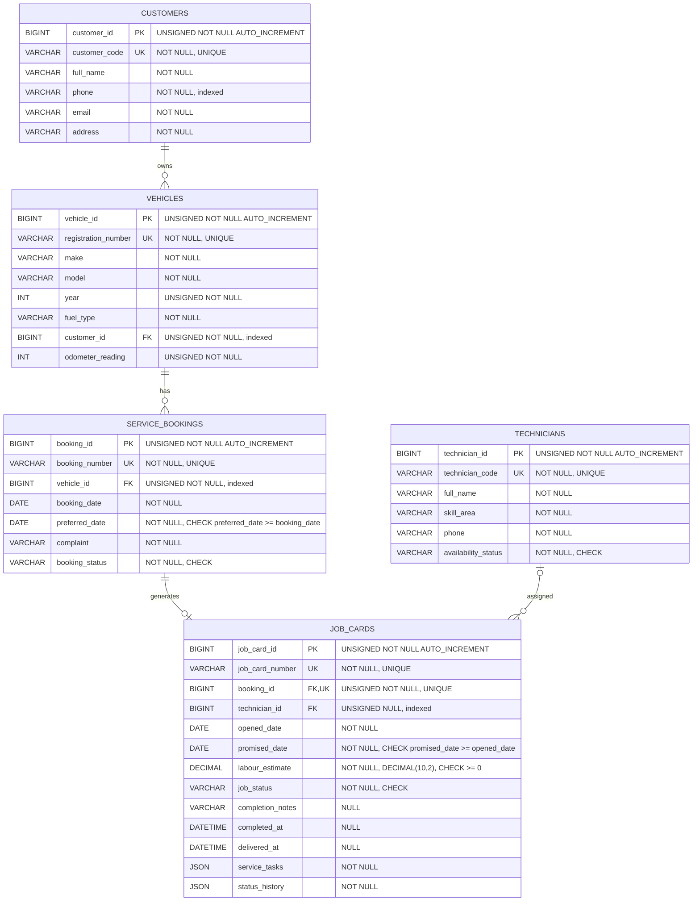

# ER Diagram

## Relationship notes
- A customer owns zero or more vehicles.
- A vehicle has zero or more service bookings.
- A service booking generates zero or one job card; `job_cards.booking_id` is unique.
- A job card has zero or one assigned technician; a technician may be assigned to zero or more job cards.
- `completed_at` and `delivered_at` are nullable timestamps set on the first transition to `COMPLETED` and `DELIVERED`.
- Service tasks and status history are JSON columns inside `job_cards`, keeping the design to five tables.
- All five tables use `ENGINE=InnoDB`, primary keys are auto-increment unsigned integers, and foreign keys use `ON DELETE RESTRICT ON UPDATE CASCADE`.
- Indexes exist on `customers.phone`, `vehicles.customer_id`, `service_bookings.vehicle_id`/`booking_status`, and `job_cards.technician_id`/`job_status`/`promised_date`.
