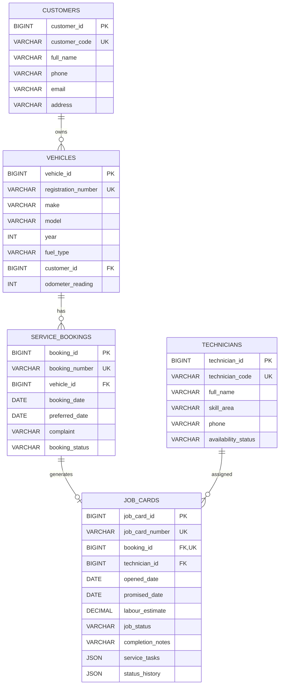

# ER Diagram

## Relationship notes
- A customer owns zero or more vehicles.
- A vehicle has zero or more service bookings.
- A service booking generates zero or one job card; `job_cards.booking_id` is unique.
- A technician may be assigned to many job cards over time.
- Service tasks and status history are JSON columns inside `job_cards`, keeping the design to five tables.
